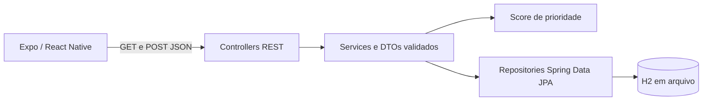

# Urban Risk Intelligence Platform — FIAP

Plataforma de monitoramento de riscos cotidianos em áreas urbanas: **alagamentos**, **ilhas de calor** e **interrupções de serviços essenciais** (energia e água). Reúne dados de sensores urbanos, bases públicas e relatos anônimos de moradores, informa a **origem** e a **confiança** de cada dado e gera **alertas priorizados** por bairro.

A solução é composta por um backend Spring Boot com banco H2 persistente e um aplicativo Expo + React Native + TypeScript.

## Integrantes

| Nome completo | RM |
| --- | --- |
| Enzo Raddatz | 556312 |
| Eric Perez Martinez Melillo Siciliano | 558651 |
| Lucas Costa Sanson | 556042 |

## Objetivo acadêmico

Projeto acadêmico da FIAP que aplica desenvolvimento Java com Spring Boot (arquitetura em camadas, validação, persistência relacional e tratamento de erros) e desenvolvimento mobile com React Native e TypeScript, em uma solução integrada de inteligência sobre riscos urbanos.

Os dados de demonstração pertencem à cidade **fictícia de Nova Ribeira**. Todos os valores são **simulados**: não representam medições reais de nenhuma cidade.

## Tecnologias e versões testadas

| Ferramenta / biblioteca | Versão |
| --- | --- |
| Java / Temurin JDK | 17.0.21+9 |
| Apache Maven | 3.9.11 |
| Spring Boot | 3.5.16 |
| H2 | 2.3.232 |
| Node.js | 26.13.0 (ver [.nvmrc](.nvmrc)) |
| npm | 11.20.0 |
| Expo SDK / pacote expo | 58 / 58.0.23 |
| React Native / React | 0.88.1 / 19.3.0 |
| TypeScript | 6.0.3 |
| Vitest / Playwright | 5.1.0 / 1.64.1 |

Instale JDK 17, Maven e Node/npm. Configure `JAVA_HOME` para a pasta do JDK 17 e adicione os executáveis ao PATH. Confira em um terminal novo:

```text
java -version
mvn -version
node --version
npm --version
```

Se o Java padrão do computador for outra versão (por exemplo, 1.8), execute o backend com o caminho completo do JDK 17, como em `"C:\Program Files\Eclipse Adoptium\jdk-17...\bin\java.exe" -jar ...`. No Windows, use `npm.cmd`/`npx.cmd` se a política do PowerShell bloquear os arquivos `.ps1`.

É necessária internet na primeira instalação de dependências. Não é preciso instalar servidor de banco: o H2 é embarcado.

## Arquitetura



```text
backend/src/main/java/br/com/fiap/urbanrisk/
  controllers/   # Endpoints REST
  services/      # Regras, transações e geração dos alertas
  analysis/      # AlertPriorityCalculator: score de prioridade (classe pura)
  privacy/       # Bloqueio de dados pessoais em relatos
  repositories/  # Persistência JPA e consultas agregadas
  entities/      # Entidades, enums e origem/confiança comuns
  dto/           # Contratos de entrada e saída
  exceptions/    # Erros em JSON
  config/        # CORS, relógio e dados simulados
mobile/
  app/                 # Rotas Expo Router (Painel, Alertas, Ocorrências, Monitoramento)
  src/providers/       # Monitoramento: reconexão automática e notificações
  src/screens/         # Painel, alertas, listagens e formulários
  src/components/      # Cartões, avisos, gráficos e ilustração
  src/features/        # Formulários, validação, privacidade, alertas e conexão
  src/services/        # Cliente REST com timeout e erros
  src/config/api.ts    # Endereço central da API
  tests/  e2e/         # Testes unitários e de interface
scripts/test-integration.mjs  # Integração ponta a ponta com backend isolado
```

## Como executar

Inicie o backend e o app em terminais separados.

### Backend

```text
cd backend
mvn spring-boot:run
```

Ou gere o JAR e execute-o (a partir de `backend/`, pois o caminho do banco é relativo):

```text
mvn verify
java -jar target/urban-risk-intelligence-0.0.1-SNAPSHOT.jar
```

API: `http://localhost:8080/api`. O banco fica em `backend/data/urban-risk.mv.db` e é preservado entre reinicializações (`ddl-auto: update`).

Na primeira inicialização com o banco vazio, o backend carrega os dados simulados de Nova Ribeira: 5 bairros, 6 sensores, 24 leituras, 6 eventos de risco e 10 relatos. Os horários são relativos ao momento da carga, para que a demonstração comece com alertas recentes. A carga não se repete em reinícios. Use `SEED_ENABLED=false` para começar sem dados.

### Mobile

```text
cd mobile
npm ci
npm start -- --go --lan --port 8081
```

Escaneie o QR code com Expo Go compatível com SDK 58 (computador e aparelho na mesma rede). No terminal do Expo, `w` abre a versão Web e `a` o Android Emulator. Para abrir direto no navegador:

```text
npm run web -- --port 8081
```

Acesse `http://localhost:8081`.

### Endereço da API usado pelo app

Sem configuração, o app usa o host do Expo: `http://localhost:8080/api` no navegador, `http://10.0.2.2:8080/api` no Android Emulator e `http://IP_DO_COMPUTADOR:8080/api` no aparelho físico. Para fixar outro endereço, copie `mobile/.env.example` para `mobile/.env`, ajuste `EXPO_PUBLIC_API_URL` e reinicie o Expo com `npm start -- --clear --port 8081`.

No aparelho físico, permita a porta 8080 no firewall e teste `http://IP_DO_COMPUTADOR:8080/api/status` no navegador do aparelho.

### Variáveis do backend

| Variável | Padrão |
| --- | --- |
| PORT | 8080 |
| DB_URL | jdbc:h2:file:./data/urban-risk |
| DB_USERNAME | sa |
| DB_PASSWORD | vazio |
| SEED_ENABLED | true |
| CORS_ORIGINS | http://localhost:8081,http://localhost:19006 |

O console H2 fica desabilitado; para inspeção local: `mvn spring-boot:run "-Dspring-boot.run.arguments=--spring.h2.console.enabled=true"` e acesse `http://localhost:8080/h2-console`.

## Domínio

| Entidade | Descrição |
| --- | --- |
| Região / bairro | Nome, cidade, descrição e coordenadas |
| Sensor urbano | `PLUVIOMETRO`, `NIVEL_RIO`, `TEMPERATURA`, `ENERGIA` ou `AGUA`; situação `OPERANTE`, `INSTAVEL` ou `OFFLINE`; pertence a uma região |
| Leitura | Valor medido por um sensor e horário da medição |
| Evento de risco | `ALAGAMENTO`, `ILHA_DE_CALOR`, `FALTA_DE_ENERGIA` ou `FALTA_DE_AGUA`; gravidade `BAIXA`, `MEDIA`, `ALTA` ou `CRITICA`; situação `ATIVO` ou `ENCERRADO` |
| Relato comunitário | Relato anônimo de morador sobre um tipo de risco em uma região |

**Origem e confiança.** Todo registro tem `source` (`SENSOR`, `BASE_PUBLICA` ou `COMUNITARIO`) e `confidence` (0 a 100). As respostas também trazem `confidenceLevel`: `ALTO` (70 ou mais), `MEDIO` (40 a 69) ou `BAIXO` (abaixo de 40). Nos relatos, a origem é sempre `COMUNITARIO` e a confiança inicial é 40, ambas atribuídas pelo servidor.

## Alertas priorizados

Os alertas são gerados a partir dos eventos de risco **ativos**. Cada um recebe um score de 0 a 100 calculado por `AlertPriorityCalculator`:

| Fator | Peso | Como é medido (0 a 100) |
| --- | --- | --- |
| Gravidade | 40% | BAIXA 25, MEDIA 50, ALTA 75, CRITICA 100 |
| Confiança da origem | 25% | confiança do evento × peso da origem (SENSOR 1,0; BASE_PUBLICA 0,9; COMUNITARIO 0,6) |
| Relatos na região | 20% | relatos do mesmo tipo de risco no mesmo bairro nas últimas 24 h; 20 pontos por relato, até 5 |
| Leitura recente | 15% | 100 se a última leitura de um sensor relacionado ao risco tem até 1 h, caindo até 0 em 24 h; 0 sem leitura |

Os sensores relacionados são: alagamento → pluviômetro e nível de rio; ilha de calor → temperatura; falta de energia → energia; falta de água → água.

Faixas de prioridade: **CRITICA** a partir de 75, **ALTA** a partir de 55, **MEDIA** a partir de 35 e **BAIXA** abaixo disso. A lista é ordenada pelo score (desempate pela gravidade e pela data mais recente). Com isso, um evento menos grave mas confirmado por sensor e por moradores pode ficar acima de um evento mais grave sem evidências.

Cada alerta da API informa origem, confiança, quantidade de relatos, horário da última leitura e o valor de cada fator.

## Proteção de dados pessoais

- O relato comunitário **não tem campos de autor, contato ou localização exata**; guarda apenas região, tipo de risco, texto e horário.
- Campos extras (por exemplo `authorName`) são recusados pela API com 400.
- O texto é recusado se contiver **e-mail, CPF, telefone ou nome declarado** ("meu nome é…", "me chamo…"). A regra existe no backend (`@NoPersonalData`) e é repetida no app, que bloqueia o envio antes de o dado sair do aparelho.
- O app informa no formulário que o relato é anônimo e quais dados não devem ser incluídos.

## Endpoints

| Recurso | Listar (GET) / cadastrar (POST) | Detalhe (GET) | Filtro |
| --- | --- | --- | --- |
| Regiões | /api/regions | /api/regions/{id} | — |
| Sensores | /api/sensors | /api/sensors/{id} | `regionId` |
| Leituras | /api/readings | /api/readings/{id} | `sensorId` |
| Eventos | /api/events | /api/events/{id} | `regionId` |
| Relatos | /api/reports | /api/reports/{id} | `regionId` |
| Alertas priorizados | GET /api/alerts | — | `regionId`, `limit` (1 a 100, padrão 50) |
| Situação da cidade | GET /api/status | — | — |

Listagens aceitam `page` e `size` (1 a 100) e retornam `content`, `page`, `size`, `totalElements` e `totalPages`. POST retorna 201 com cabeçalho `Location`. Erros retornam JSON com `timestamp`, `status`, `message`, `path` e `errors` (por campo), cobrindo dados inválidos (400), referência inexistente (404), integridade (409) e tipo de conteúdo incompatível (415). Datas são ISO 8601 com fuso e não podem estar no futuro.

`/api/status` informa `CRITICO` quando há alerta de prioridade crítica, `ATENCAO` quando há eventos ativos ou sensores instáveis/offline, `NORMAL` sem riscos e `SEM_DADOS` sem regiões.

Exemplo no PowerShell, com o backend executando:

```powershell
$api = "http://localhost:8080/api"
Invoke-RestMethod "$api/status"
Invoke-RestMethod "$api/alerts" | Select-Object score, priority, source, confidence, regionName, title
$body = @{ regionId = 1; riskType = "ALAGAMENTO"; description = "Bueiro transbordando na esquina."; occurredAt = [DateTime]::UtcNow.ToString("o") } | ConvertTo-Json
Invoke-RestMethod -Method Post -Uri "$api/reports" -ContentType "application/json; charset=utf-8" -Body ([System.Text.Encoding]::UTF8.GetBytes($body))
```

Esse POST grava um relato no banco local. Para preservar os dados de uma demonstração, use um backend isolado.

## Aplicativo

- **Painel:** apresentação do projeto e da equipe, situação da cidade, indicadores (bairros, sensores, riscos ativos e relatos), os três alertas mais prioritários, situação da rede de sensores e gráfico de leituras por sensor.
- **Alertas:** lista priorizada com filtro por tipo de risco. Cada alerta mostra score, prioridade, gravidade, **origem**, **confiança** e os fatores que explicam a prioridade.
- **Ocorrências:** eventos de risco e relatos comunitários, com cadastro.
- **Monitoramento:** bairros, sensores e leituras, com cadastro.

**Aviso de desconexão e reconexão automática.** O app consulta a API periodicamente. Sem conexão, mostra um aviso no topo da tela com a contagem até a próxima tentativa e tenta reconectar sozinho, com espera crescente (2, 4, 8, 15 e 30 segundos). O aviso não bloqueia o uso: a navegação continua e os últimos dados recebidos permanecem visíveis. Ao reconectar, o app mostra "Conexão restabelecida" e recarrega as telas. Há também o botão "Tentar agora".

**Notificações de alerta.** Novos alertas de prioridade alta ou crítica geram um aviso no app, com acesso direto à lista de alertas; a aba Alertas mostra a quantidade de alertas prioritários. As notificações são exibidas dentro do aplicativo (não são notificações push do sistema).

**Acessibilidade.** Textos em tamanho confortável, áreas de toque de pelo menos 44 pontos, contraste alto, origem e confiança escritas por extenso (não apenas por cor), descrições para leitores de tela e respeito à preferência de movimento reduzido.

Na versão Web, uma apresentação inicial de 7 segundos é exibida ao abrir ou recarregar a página; a API é consultada em paralelo. Android e iOS usam a inicialização nativa do Expo.

## Testes automatizados

### Backend

```text
cd backend
mvn verify
```

Inclui testes unitários do score de prioridade e da detecção de dados pessoais, integração da API em H2 em memória (fluxo completo, alertas ordenados, privacidade e validações), o cenário da cidade simulada e a persistência em arquivo após reinício.

### Mobile

```text
cd mobile
npm ci
npm run typecheck
npm test
```

### Integração ponta a ponta (backend isolado)

Com o JAR gerado (`mvn verify`) e `JAVA_HOME` apontando para o JDK 17, na raiz:

```text
node scripts/test-integration.mjs
```

O script inicia o JAR em uma porta livre com um banco H2 em pasta temporária, confere a carga simulada, a ordem dos alertas, a recusa de relato com telefone e a persistência após reinício. Para também executar o cliente do app contra a API real e os testes de interface no Chromium (inclusive a reconexão automática):

```text
cd mobile
npx playwright install chromium
cd ..
node scripts/test-integration.mjs --with-mobile
```

O script não usa o banco de desenvolvimento nem as portas 8080/8081 e remove somente a pasta temporária que criou. As opções diretas `npm run test:api` e `npm run test:e2e` fazem cadastros na API configurada em `EXPO_PUBLIC_API_URL`; prefira o script acima.

## Resultados registrados — 18/11/2026

Execuções realizadas no Windows com as versões da tabela inicial:

| Verificação | Resultado |
| --- | --- |
| Backend, `mvn verify` | BUILD SUCCESS; 28 testes passaram |
| TypeScript do mobile | Sem erros |
| Testes unitários do mobile | 92 passaram |
| Integração do app com a API real (backend isolado) | 1 teste passou |
| Interface no Chromium, celular e desktop (backend isolado) | 16 testes passaram |
| `scripts/test-integration.mjs --with-mobile` | Concluído sem falhas |
| App em execução (Expo Web, porta 8081) com backend local (porta 8080) | Painel carregado com dados da API, sem cadastros |

Não foram executados nesta etapa: Expo Doctor, exportação de bundles (`npx expo export`), testes em aparelho físico, builds de release (APK/IPA) ou avaliação de desempenho.

## Dados e publicação

Os ignores protegem o banco H2, variáveis locais, dependências, ferramentas portáteis (`.tools/`), builds, relatórios e logs. `.env.example`, scripts e lockfiles são versionados. A API acadêmica não possui autenticação; as instruções deste README são para execução local.
