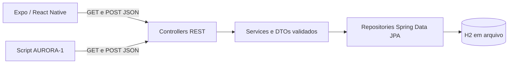

# Space Mission Control — FIAP

Aplicativo de controle de missão espacial com backend Spring Boot, banco H2 persistente e mobile Expo + React Native + TypeScript. Permite cadastrar e consultar módulos, sensores, sistemas, leituras, eventos e alertas, além de acompanhar o status geral da missão.

## Objetivo acadêmico

Projeto acadêmico da FIAP que aplica desenvolvimento Java com Spring Boot, persistência relacional e desenvolvimento mobile com React Native e TypeScript em uma solução integrada. O cenário de uma missão espacial permite demonstrar contratos REST GET/POST, validação de dados, relacionamentos, tratamento de erros e consulta de telemetria em uma interface responsiva.

A missão fictícia AURORA-1 contextualiza a demonstração. Seus registros são cadastrados e consultados pela API, com persistência no H2 em arquivo; a apresentação institucional da home é conteúdo estático separado dos dados operacionais.

## Integrantes

| Nome completo | RM |
| --- | --- |
| Enzo Raddatz | 556312 |
| Eric Perez Martinez Melillo Siciliano | 558651 |
| Lucas Costa Sanson | 556042 |

## Tecnologias e versões testadas

| Ferramenta / biblioteca | Versão |
| --- | --- |
| Java / Temurin JDK | 17.0.21+9 |
| Apache Maven | 3.9.11 |
| Spring Boot | 3.5.16 |
| H2 | 2.3.232 |
| Node.js | 26.13.0 |
| npm | 11.20.0 |
| Expo SDK / pacote expo | 58 / 58.0.23 |
| React Native / React | 0.88.1 / 19.3.0 |
| TypeScript | 6.0.3 |
| Vitest / Playwright | 5.1.0 / 1.64.1 |

Use JDK 17 e a versão de Node indicada em [.nvmrc](.nvmrc). O `mobile/package.json` também declara as faixas de Node aceitas pelo SDK instalado; outras versões não foram testadas nesta entrega. As dependências transitivas são gerenciadas pelo Spring Boot e por `mobile/package-lock.json`.

Instale JDK, Maven e Node/npm no computador que executará o projeto. Configure `JAVA_HOME` para a pasta do JDK e adicione os executáveis ao PATH. Abra um terminal novo e confira:

```text
java -version
javac -version
mvn -version
node --version
npm --version
```

É necessária internet na primeira instalação de dependências. Não é preciso instalar um servidor de banco: o H2 é embarcado. Não há Maven Wrapper; Maven precisa estar instalado.

No Windows, use `npm.cmd` e `npx.cmd` se a política do PowerShell bloquear os arquivos `.ps1`. Os comandos `npm` abaixo também podem ser executados dessa forma. O simulador iOS exige macOS; no Windows, use Expo Web, Android Emulator ou aparelho com Expo Go compatível com SDK 58.

## Arquitetura



```text
README.md
backend/
  pom.xml
  src/main/java/br/com/fiap/spacemission/
    controllers/   # Endpoints REST
    services/      # Regras e transações
    repositories/  # Persistência JPA
    entities/      # Entidades, enums e relacionamentos
    dto/           # Contratos de entrada, saída e paginação
    exceptions/    # Erros JSON
    config/        # CORS e exemplos iniciais
    migration/     # CLI local, separada da inicialização normal
      PresentationCleanupCommand.java
      PresentationCleanupService.java
  src/main/resources/application.yml
  src/test/java/br/com/fiap/spacemission/
    ApiIntegrationTest.java
    FilePersistenceTest.java
    PresentationCleanupTest.java
mobile/
  app/            # Rotas e layouts Expo Router
  src/screens/    # Dashboard, listagens e formulários reutilizáveis
  src/components/ # Controles, cartões, gráficos e estados
    project-introduction.tsx
    team-member-card.tsx
    floating-astronaut.tsx
    startup-presentation.web.tsx
    startup-presentation.tsx
    startup-progress.tsx
  src/theme/      # Tokens e cores do design system
  src/services/   # Cliente REST, timeout e erros
  src/config/
    api.ts        # Endereço central da API
    project-info.ts # Texto institucional e integrantes
  src/features/   # Formulários, validação e cálculos dos indicadores
    startup-sequence.ts
  tests/          # Testes unitários e integração opt-in
    client.test.ts
    validation.test.ts
    mission-metrics.test.ts
    related-records.test.ts
    startup-sequence.test.ts
    live.test.ts
  e2e/            # Interface no Chromium
    app.spec.ts
    project-introduction.spec.ts
    related-records.spec.ts
    startup.spec.ts
  playwright.config.mts
  .env.example
scripts/
  seed-aurora-1.mjs                     # Reprodução pela API
  seed-aurora-1.test.mjs                # Testes unitários do script
  test-aurora-1.integration.mjs         # API, H2 e mobile isolados
  test-presentation-cleanup.integration.mjs # Migração em cópia isolada
```

Árvore resumida dos arquivos relevantes à execução e aos testes. No mobile, o Expo Router organiza as rotas; as telas utilizam componentes e tokens visuais compartilhados, e o cliente REST centraliza o acesso à API. A migração textual é uma ferramenta opcional para dados existentes e não participa da carga AURORA-1 em um banco novo.

Sensores e sistemas pertencem a módulos. Leituras pertencem a sensores. Eventos e alertas pertencem a sistemas. O backend valida as referências e mantém chaves estrangeiras no H2.

## Execução padrão

Com as dependências instaladas, inicie o backend e o Expo em terminais separados. Este procedimento não depende das ferramentas portáteis locais em `.tools/`.

### Backend

Partindo da raiz:

```text
cd backend
mvn spring-boot:run
```

API: `http://localhost:8080/api`. Para gerar o JAR e executá-lo:

```text
mvn verify
java -jar target/space-mission-control-0.0.1-SNAPSHOT.jar
```

Execute o backend a partir de `backend/`, pois a URL padrão do H2 é relativa ao diretório de execução. Encerre com Ctrl+C antes de iniciar outra instância usando o mesmo arquivo.

O arquivo padrão é `backend/data/space-mission.mv.db`. A configuração `ddl-auto: update` preserva os dados entre inicializações. Não apague esse arquivo para executar os testes ou recriar a demonstração.

A carga inicial do backend é transacional e só ocorre se todas as tabelas de domínio estiverem vazias. Ela cria exemplos básicos, sem duplicação no reinício. Use `SEED_ENABLED=false` para começar sem esses exemplos. A missão completa AURORA-1 é preparada pelo script descrito abaixo.

### Mobile

Em outro terminal, partindo da raiz:

```text
cd mobile
npm ci
npm start -- --go --lan --port 8081
```

Escaneie o QR code com Expo Go compatível com SDK 58. Computador e aparelho precisam estar na mesma rede. No terminal do Expo, `a` abre o Android Emulator e `w` abre a versão Web.

Para abrir diretamente no navegador:

```text
npm run web -- --port 8081
```

Acesse `http://localhost:8081`. Use Ctrl+C para encerrar o Expo.

Para usar aparelho físico, outro endereço de backend ou outra origem Web, consulte [Configurações locais opcionais](#configurações-locais-opcionais). A API acadêmica não possui autenticação; as instruções deste README são para execução local.

## Apresentação e funcionalidades do aplicativo

### Home e integrantes

A tela inicial apresenta o título **Space Mission Control**, a descrição do projeto, o selo **MISSÃO AURORA-1** e os cartões **EQUIPE DO PROJETO**, com os três nomes completos e RMs da tabela Integrantes. Esse conteúdo é definido em `mobile/src/config/project-info.ts` e renderizado por `ProjectIntroduction` e `TeamMemberCard`. O dashboard operacional permanece logo abaixo, com informações consultadas pela API.

O astronauta é uma ilustração SVG desenhada no componente `FloatingAstronaut`, com `react-native-svg`, sem imagem externa. Sua flutuação suave usa React Native Reanimated; a animação respeita a preferência de movimento reduzido e pausa quando o aplicativo está em segundo plano. A home adapta a disposição da ilustração e dos cartões à largura disponível, permitindo a quebra dos nomes longos.

### Splash personalizada na versão Web

A versão Web utiliza uma apresentação inicial personalizada de **7 segundos**, com título, selo da missão, astronauta, mensagens de inicialização, barra de progresso e porcentagem. Ao concluir a sequência, há uma transição de saída de 300 ms; com movimento reduzido, essa transição é imediata.

A apresentação é exibida ao carregar ou recarregar a página, sem reaparecer ao navegar entre as abas. O aplicativo e as consultas à API são iniciados em paralelo: a porcentagem representa o tempo da apresentação e não mede o carregamento real dos dados. Erros e estados de carregamento da API continuam sendo tratados pelo dashboard.

Essa sequência está em `mobile/src/components/startup-presentation.web.tsx`, com os tempos definidos em `mobile/src/features/startup-sequence.ts`. **Android e iOS mantêm a inicialização nativa do Expo**, sem acrescentar o temporizador de 7 segundos.

### Telas

- **Visão geral:** apresentação do projeto, integrantes, status, contagens, saúde da infraestrutura e telemetria por sensor.
- **Telemetria:** sensores e leituras, com listagens e formulários.
- **Estrutura:** módulos e sistemas, com listagens e formulários.
- **Operações:** eventos e alertas críticos, com listagens e formulários.

Há atualização manual, gesto de atualizar, paginação, busca nos registros carregados e mensagens de carregamento, vazio, erro e confirmação. Após um cadastro, a listagem é consultada novamente.

O gráfico utiliza até 24 leituras recentes por cadastro de um único sensor, ordenadas por data de medição. Não combina unidades diferentes nem cria medições. Sem leituras há um estado vazio; com apenas uma há um ponto, sem tendência inventada. A ilustração orbital é decorativa.

## Configurações locais opcionais

### Variáveis do backend

Use estas configurações para mudar os padrões de execução. As ferramentas portáteis são descritas separadamente em [Ferramentas portáteis locais opcionais](#ferramentas-portáteis-locais-opcionais).

| Variável | Padrão |
| --- | --- |
| PORT | 8080 |
| DB_URL | jdbc:h2:file:./data/space-mission |
| DB_USERNAME | sa |
| DB_PASSWORD | vazio |
| SEED_ENABLED | true |
| CORS_ORIGINS | http://localhost:8081,http://localhost:19006 |

Variáveis são lidas do ambiente; o backend não carrega arquivos `.env` automaticamente. Exemplo no PowerShell: `$env:PORT = "8082"`. Em bash/zsh: `export PORT=8082`. Para outro caminho de banco, configure `DB_URL` com uma URL H2 em arquivo.

### Console H2

O console H2 fica desabilitado por padrão. Para inspeção local opcional, execute em `backend/`:

```text
mvn spring-boot:run "-Dspring-boot.run.arguments=--spring.h2.console.enabled=true"
```

Abra `http://localhost:8080/h2-console` e informe a URL, usuário e senha configurados.

### Endereço da API

Copie `mobile/.env.example` para `mobile/.env` e ajuste `EXPO_PUBLIC_API_URL`:

| Ambiente | Endereço |
| --- | --- |
| Expo Web neste computador | http://localhost:8080/api |
| Android Emulator padrão | http://10.0.2.2:8080/api |
| Aparelho físico | http://IP_DO_COMPUTADOR:8080/api |
| Simulador iOS local | http://localhost:8080/api |

Em aparelho físico, substitua `IP_DO_COMPUTADOR` pelo IPv4 Wi-Fi real do computador que executa o backend. Consulte `ipconfig` no Windows ou as configurações de rede. Permita acesso à porta 8080 no firewall e teste `/api/mission/status` no navegador do aparelho.

Reinicie o Expo após alterar a variável. Se necessário, use `npm start -- --clear --port 8081`. A configuração fica em `mobile/src/config/api.ts`; não há localhost fixado nas telas. Sem variável explícita, o app tenta detectar o computador pelo host do Expo. O túnel do Expo não disponibiliza a API Spring Boot.

Para Expo Web em outro IP/origem, ajuste `CORS_ORIGINS` do backend e reinicie-o. O padrão já permite `http://localhost:8081`. CORS não restringe o cliente nativo. Variáveis `EXPO_PUBLIC_*` são públicas no bundle; não inclua senhas nelas.

## Missão AURORA-1

A AURORA-1 é um cenário fictício de apresentação acadêmica: navegação orbital, comunicação e monitoramento ambiental, com uma queda simulada de pressão que mantém o suporte à vida sob atenção. Os dados são persistidos pela API, não inseridos no frontend.

O script cria ou reaproveita:

- Computador central, computador de navegação e módulo de comunicação.
- Sensores de temperatura (`°C`), pressão (`kPa`) e oxigênio (`%`).
- Sistemas de suporte à vida, propulsão e comunicação.
- Quinze leituras: cinco por sensor.
- Quatro eventos: correção orbital, enlace estabelecido, queda de pressão e contingência.
- Um alerta crítico ativo.

| Série | Cinco medições |
| --- | --- |
| Temperatura | 24,1; 24,3; 24,4; 24,6; 24,8 °C |
| Pressão | 101,3; 100,5; 97,8; 93,6; 88,9 kPa |
| Oxigênio | 20,9; 20,9; 20,8; 20,9; 20,8 % |

### Reproduzir pela API

Com o backend executando, abra um terminal na raiz:

```text
node scripts/seed-aurora-1.mjs
```

Para configurar outro backend:

```text
node scripts/seed-aurora-1.mjs --api-url http://localhost:18080/api
node scripts/seed-aurora-1.mjs --help
```

Alternativa no PowerShell:

```powershell
$env:AURORA_API_URL = "http://localhost:18080/api"
node scripts/seed-aurora-1.mjs
```

Em bash/zsh, use `export AURORA_API_URL=http://localhost:18080/api`. A opção `--api-url` prevalece sobre a variável. Uma URL sem caminho recebe `/api` automaticamente.

O script usa somente GET e POST. Não depende de H2 local, ferramentas de `.tools/`, IDs fixos, arquivos de manifesto ou acesso direto ao banco. Os IDs de cada criação/consulta são reutilizados nos relacionamentos. O resumo JSON mostra os IDs encontrados, as criações, os reaproveitamentos e os totais reais.

**Reexecutar é permitido:** antes de cada possível POST, o script consulta os registros. Reconhece também nomes legados como “Computador de bordo”, “Temperatura da cabine” e “Suporte à vida”. Um alerta ativo anterior compatível é reaproveitado sem mudar sua data.

O primeiro evento AURORA-1 registra a origem temporal da demonstração no próprio backend. As próximas execuções recuperam esse evento para reutilizar as mesmas datas e leituras, inclusive após uma interrupção. Não há repetição automática de POST quando a resposta se perde.

Se houver nomes ambíguos ou um registro com relacionamento, status, unidade ou valor incompatível, o script interrompe e preserva o existente. Cadastros já concluídos permanecem salvos; corrija a ambiguidade conscientemente antes de retomar. Execute uma instância do script por vez: a API não oferece restrição de unicidade para duas cargas simultâneas.

Em banco completamente vazio e com `SEED_ENABLED=false`, o cenário contém **3 módulos, 3 sensores, 3 sistemas, 15 leituras, 4 eventos e 1 alerta**. Em banco já utilizado, os totais podem ser maiores: exemplos básicos, testes e registros anteriores são preservados. A API não gera alertas automaticamente pelas leituras; o alerta do cenário é cadastrado explicitamente.

## Endpoints e contratos

| Recurso | Listar GET / cadastrar POST | Detalhe GET |
| --- | --- | --- |
| Módulos | /api/modules | /api/modules/{id} |
| Sensores | /api/sensors | /api/sensors/{id} |
| Sistemas | /api/systems | /api/systems/{id} |
| Leituras | /api/readings | /api/readings/{id} |
| Eventos | /api/events | /api/events/{id} |
| Alertas | /api/alerts | /api/alerts/{id} |
| Status | GET /api/mission/status | — |

Listagens aceitam `page=0&size=20`, tamanho de 1 a 100, e retornam `content`, `page`, `size`, `totalElements` e `totalPages`. Há filtros por `moduleId` em sensores/sistemas, `sensorId` em leituras e `systemId` em eventos/alertas.

- Saúde dos componentes: `OPERATIONAL`, `DEGRADED`, `OFFLINE`.
- Severidade dos eventos: `INFO`, `WARNING`, `CRITICAL`.
- Situação dos alertas: `ACTIVE`, `RESOLVED`.
- Datas ISO 8601 com fuso, sem datas futuras.
- Leituras com até 12 dígitos inteiros e 6 casas decimais, incluindo negativos.

POST retorna 201, recurso criado e Location. Erros retornam JSON com `timestamp`, `status`, `message`, `path` e `errors`. São tratados dados inválidos (400), referência inexistente (404), integridade (409) e tipo de conteúdo incompatível (415).

O status é CRITICAL quando há alerta ativo ou componente offline; WARNING para componente degradado; UNKNOWN sem componentes; NOMINAL nos demais casos. Componentes incluem módulos, sensores e sistemas. Não há PUT/PATCH/DELETE nesta etapa; os status são informados no cadastro.

### Testar GET e POST

No PowerShell, com o backend executando:

```powershell
$api = "http://localhost:8080/api"
Invoke-RestMethod "$api/mission/status"
Invoke-RestMethod "$api/sensors"

function New-MissionResource($resource, $data) {
    $body = $data | ConvertTo-Json
    Invoke-RestMethod -Method Post -Uri "$api/$resource" -ContentType "application/json; charset=utf-8" -Body ([System.Text.Encoding]::UTF8.GetBytes($body))
}
$module = New-MissionResource "modules" @{
    name = "Computador auxiliar"; description = "Exemplo manual"; status = "OPERATIONAL"
}
$sensor = New-MissionResource "sensors" @{
    name = "Temperatura externa"; type = "TEMPERATURE"; unit = "C"
    status = "OPERATIONAL"; moduleId = $module.id
}
$system = New-MissionResource "systems" @{
    name = "Navegacao auxiliar"; description = "Exemplo manual"
    status = "OPERATIONAL"; moduleId = $module.id
}
New-MissionResource "readings" @{
    sensorId = $sensor.id; value = -12.5; recordedAt = [DateTime]::UtcNow.ToString("o")
}
New-MissionResource "events" @{
    systemId = $system.id; title = "Manobra validada"; description = "Exemplo manual"
    severity = "INFO"; occurredAt = [DateTime]::UtcNow.ToString("o")
}
New-MissionResource "alerts" @{
    systemId = $system.id; title = "Verificar telemetria"; description = "Exemplo manual"
    status = "ACTIVE"; occurredAt = [DateTime]::UtcNow.ToString("o")
}
Invoke-RestMethod "$api/modules/$($module.id)"
Invoke-RestMethod "$api/readings?sensorId=$($sensor.id)"
```

Esses comandos cadastram registros. Para preservar uma demonstração já preparada, use um backend isolado. No Postman/Insomnia, use os mesmos endpoints e Body JSON. Exemplo:

```json
{"name":"Computador auxiliar","description":"Exemplo manual","status":"OPERATIONAL"}
```

## Testes automatizados

### Backend e script

```text
cd backend
mvn verify
cd ..
node --test scripts/seed-aurora-1.test.mjs
node scripts/test-aurora-1.integration.mjs
```

O backend testa GET/POST e validações em H2 em memória; outro teste reabre um arquivo temporário para verificar persistência. O teste do script cobre IDs dinâmicos, paginação, repetição, falha após commit, nomes legados e conflitos.

O teste de integração inicia o JAR com JDK 17, portas livres e bancos H2 em arquivo dentro de uma pasta temporária. Verifica banco vazio, repetição sem novos registros, reinício com dados persistidos e reaproveitamento dos exemplos básicos. Não acessa o banco de desenvolvimento e remove somente a pasta temporária que ele próprio criou.

### Mobile

```text
cd mobile
npm ci
npm run typecheck
npm test
npm run doctor
npx expo export --platform all
```

A exportação gera bundles em `mobile/dist/`; não cria APK/IPA nem publica o aplicativo.

Para executar também os testes GET/POST e os testes de interface contra um backend isolado:

```text
cd mobile
npx playwright install chromium
cd ..
node scripts/test-aurora-1.integration.mjs --with-mobile
```

O harness fornece a URL do backend temporário e uma porta Web livre. O Playwright bloqueia requisições para outra API quando `EXPO_PUBLIC_API_URL` foi configurada. Os backends locais 8080 e 8081 não são encerrados nem recebem POSTs desses testes.

As opções diretas `npm run test:api` e `npm run test:e2e` continuam disponíveis, mas fazem cadastros. Para apontá-las a um ambiente de teste preparado separadamente, configure `EXPO_PUBLIC_API_URL`; para outra porta do Expo de teste, configure `EXPO_WEB_PORT`. Prefira o harness acima para preservar os dados da apresentação.

## Migração controlada dos textos de apresentação

A limpeza de registros existentes é um comando separado do servidor, desativado na execução normal. Não adiciona PUT/PATCH à API. Ela usa uma única transação JPA, compara o inventário completo antes de gravar e permite apenas `name`, `title` e `description` nos recursos apropriados. Leituras, IDs, vínculos, status, datas, tipos e unidades não são editáveis. Divergências provocam aborto integral; repetir uma migração já aplicada não altera registros.

Antes de executar, consulte todos os recursos por GET, encerre somente o backend e aguarde o fechamento do H2. Faça um backup físico offline, confira seu SHA-256 e mantenha banco, manifesto e relatórios numa pasta ignorada pelo Git. Não copie o arquivo H2 enquanto estiver em uso.

O manifesto JSON contém `scope: "space-mission-control/presentation-text-cleanup/v1"`, `records` com as seis coleções completas ordenadas por ID e `changes` com entradas `{ "resource": "modules", "id": ID_EXISTENTE, "after": { "name": "Nome aprovado" } }`. Os valores devem ser previamente revisados e aprovados; não use o manifesto de um banco em outro.

Após `cd backend` e `mvn verify`, volte à raiz. Crie a pasta local `.tools/cleanup-run/` para guardar o manifesto aprovado e os relatórios. Exemplo para os arquivos locais de uma execução previamente preparada:

```text
java -Dloader.main=br.com.fiap.spacemission.migration.PresentationCleanupCommand -cp backend/target/space-mission-control-0.0.1-SNAPSHOT.jar org.springframework.boot.loader.launch.PropertiesLauncher --database-file backend/data/space-mission.mv.db --manifest .tools/cleanup-run/approved-manifest.json --report .tools/cleanup-run/dry-run.json
```

Esse comando apenas simula. Para aplicar, acrescente `--apply` e informe um **novo** arquivo em `--report`; relatórios existentes não são sobrescritos. O banco deve existir, estar fechado e corresponder integralmente ao manifesto. O comando usa validação de schema, sem carga inicial ou criação de registros. Depois, reinicie o backend normalmente e compare todas as respostas GET ao inventário anterior, permitindo somente os textos aprovados.

Para testar primeiro em uma cópia isolada do backup, com o backend local ainda parado:

```text
node scripts/test-presentation-cleanup.integration.mjs --backup CAMINHO_DO_BACKUP.mv.db --manifest .tools/cleanup-run/approved-manifest.json --expected-sha256 HASH_DO_BACKUP --report .tools/cleanup-run/isolated-migration-report.json
```

O teste modifica somente a cópia temporária que cria. Confere simulação, recusa de conflitos, aplicação exata, preservação dos demais campos, persistência e repetição sem alterações. Os dados locais e backups não acompanham o GitHub; para um banco novo, continue usando `scripts/seed-aurora-1.mjs`.

Registro da migração realizada em **06/11/2026**: a limpeza foi testada primeiro numa cópia física isolada; depois, os 52 registros locais foram conferidos individualmente por GET. Somente os 38 campos textuais aprovados em 21 registros mudaram; os outros 31 registros, as 18 leituras e todos os vínculos/estados foram preservados. O backup e os relatórios detalhados permanecem na pasta local ignorada `.tools/`. Os resultados das suítes automatizadas estão separados por etapa na seção [Resultados registrados das verificações](#resultados-registrados-das-verificações).

## Dependências e preparação para publicação

Os ignores protegem o H2, variáveis locais, dependências, ferramentas portáteis, builds, relatórios, logs, arquivos temporários e credenciais. `.env.example`, scripts de reprodução e lockfiles são destinados ao versionamento.

A última consulta registrada de `npm audit --omit=dev`, em **06/11/2026**, identificou **5 ocorrências moderadas**, sem ocorrências altas ou críticas nesse escopo, na cadeia de ferramentas Expo: `glob@13.0.6` e `minimatch@10.2.6`, propagadas para Expo CLI/fingerprint. Naquela verificação, as correções publicadas estavam em `glob >=14.0.2` e `minimatch >=11.0.1`, fora das faixas utilizadas pelos consumidores. A simulação de `npm audit fix` sem force não removeu esses avisos.

Não foram aplicados overrides de versão principal, `audit fix --force` nem downgrade do Expo. Os avisos permanecem pendentes de uma atualização compatível dos consumidores. Referências: [advisory glob](https://github.com/advisories/GHSA-3g3m-2fjr-6pw4), [advisory minimatch](https://github.com/advisories/GHSA-g3hv-75wg-m249). Reavalie com `npm audit --omit=dev` antes de uma futura atualização.

Os integrantes oficiais e seus RMs constam na tabela Integrantes e em `mobile/src/config/project-info.ts`. Nenhum repositório Git é inicializado por estes comandos e nenhum script faz commits ou publicações.

## Resultados registrados das verificações

Os resultados abaixo correspondem às execuções já realizadas no Windows, com as versões documentadas. Cada grupo identifica a etapa e o escopo testado; a revisão atual altera somente este README e não representa uma nova execução das suítes.

### Última suíte geral registrada — 06/11/2026

| Verificação | Resultado real |
| --- | --- |
| Backend, `mvn verify` | BUILD SUCCESS; 6 testes passaram |
| Script AURORA-1, `node --test` | 8 testes passaram |
| Reprodução real em H2 isolado | Banco novo, IDs, vínculos, repetição e persistência após reinício validados |
| TypeScript do mobile | Sem erros |
| Testes unitários do mobile | 60 passaram |
| Integração GET/POST do mobile | 1 teste passou contra o backend temporário |
| Interface, celular e desktop | 18 testes passaram contra o backend temporário |

Na auditoria geral dessa data, o Expo Doctor aprovou 20/20 verificações e foram gerados bundles Web, Android e iOS. A migração textual também foi validada em cópia isolada, incluindo preservação dos campos protegidos, recusa de conflitos e repetição sem alterações.

### Validação mais recente da splash — 06/11/2026

Após a remoção das duas linhas explicativas inferiores da splash, foram executadas verificações específicas:

| Verificação | Resultado real |
| --- | --- |
| TypeScript do mobile | Sem erros |
| `tests/startup-sequence.test.ts` | 9 testes passaram |
| `e2e/startup.spec.ts`, projetos celular e desktop | 4 testes passaram |

Essa validação verificou a sequência de 7 segundos, a ausência dos textos removidos, a navegação/recarga, o movimento reduzido e a apresentação de erro da API. A suíte geral de 18 testes de interface foi executada antes desse ajuste; não foi repetida integralmente depois dele.

### Histórico da etapa anterior — 05/11/2026

Os números abaixo são preservados como registro anterior à ampliação dos testes e à migração textual; não representam a quantidade atual de testes:

| Verificação | Resultado real |
| --- | --- |
| Backend, `mvn verify` | BUILD SUCCESS; 2 testes passaram |
| Script AURORA-1, `node --test` | 8 testes passaram |
| Reprodução real em H2 isolado | Banco vazio, repetição, reinício e exemplos legados validados |
| TypeScript do mobile | Sem erros |
| Testes unitários do mobile | 47 passaram |
| Integração GET/POST do mobile | 1 teste passou contra o backend temporário |
| Interface, celular e desktop | 6 testes passaram contra o backend temporário |
| Expo Doctor | 20/20 verificações aprovadas |
| Exportação Expo | Bundles Android, iOS e Web gerados |
| Regras de ignore | 21 verificações aprovadas, incluindo scripts versionáveis |
| Banco local anterior aos testes | Os 52 registros permaneceram idênticos, conferidos por GET |
| npm audit online, sem dependências de desenvolvimento | 5 ocorrências moderadas; nenhuma alta ou crítica nesse escopo |

Naquela etapa, os testes de cadastro foram direcionados aos backends temporários, e a verificação não exigiu alterações no código-fonte do backend ou nas telas do mobile.

### Dados locais e limites das verificações

Na última conferência somente por GET, o banco local manteve **14 módulos, 5 sensores, 5 sistemas, 18 leituras, 7 eventos e 3 alertas**: 52 registros, missão **CRITICAL**, com 1 alerta ativo e 2 resolvidos. Esses totais pertencem ao banco local já utilizado; um banco novo preparado exclusivamente pelo script AURORA-1 tem os totais descritos na seção da missão.

Não houve teste em aparelho físico, avaliação de desempenho em build release, geração de APK/IPA ou execução em outro sistema operacional. As exportações e os testes Web não substituem essas verificações. Nesta revisão documental, não foram alterados código, banco, configurações ou scripts, nem executados comandos Git ou publicações.

## Ferramentas portáteis locais opcionais

`.tools/` não faz parte da entrega e não é necessária para os scripts. Nesta máquina, quem optar pelas ferramentas já baixadas pode configurar o terminal PowerShell na raiz:

```powershell
$env:JAVA_HOME = (Get-ChildItem ".tools" -Directory -Filter "jdk-17*" | Select-Object -First 1).FullName
$mavenHome = (Get-ChildItem ".tools" -Directory -Filter "apache-maven-*" | Select-Object -First 1).FullName
$nodeHome = (Get-ChildItem ".tools" -Directory -Filter "node-*-win-x64" | Select-Object -First 1).FullName
$env:Path = "$env:JAVA_HOME\bin;$mavenHome\bin;$nodeHome;$env:Path"
```

Em outro computador, instale as dependências da tabela inicial; não copie o banco H2 nem ferramentas pessoais para o repositório.
